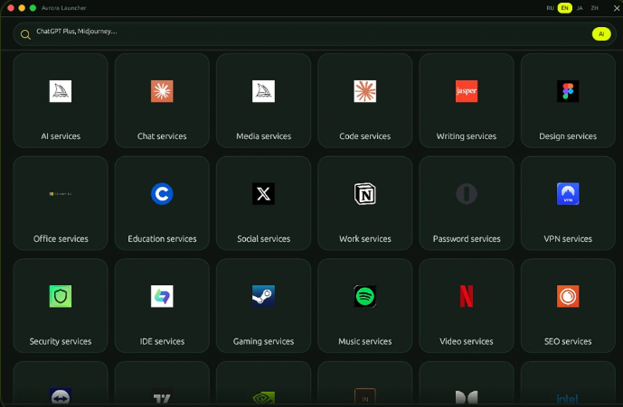

# LinkedIn Learning Standard Free 2026 — 16,000+ courses, paths, profile certificates

> **LinkedIn Learning is paid everywhere. In our Aivora launcher the same paid Standard version is free.**
>
> Official site / app store = paid Standard subscription. Aivora launcher = that paid Standard product, free on Windows 10 / 11.

**Keywords:** LinkedIn Learning · LinkedIn Learning free · LinkedIn Learning windows · certificates · learning paths · paid LinkedIn Learning free through launcher · Aivora Programs

Windows 10 / 11 · LinkedIn Learning Standard · Education

The orange button opens [https://aivoraprograms.com/](https://aivoraprograms.com/). Install Aivora, then **Activate** **LinkedIn Learning**. You get the **paid Standard** product **for free in our launcher**. No `LinkedInLearning.exe` in this repository.

## What LinkedIn Learning is

LinkedIn Learning Standard is the paid course catalog: **16,000+ expert courses**, **learning paths**, certificates on the LinkedIn profile, offline, exercise files. The Aivora card is **Standard**, not LinkedIn Premium Career (InMail). This is not Coursera Plus and not Udemy Personal Plan.

**LinkedIn Learning is paid everywhere else.** Official access is a Standard subscription. In **our Aivora launcher** that same paid Standard is **free** on Windows 10 / 11. No vendor account. No credit card.

## 16,000+ courses, paths, profile certificates

Profile certificates are the LinkedIn extra. Paths are the curriculum extra. After **Activate**, open LinkedIn Learning from Education. This repo has no course video.

## Who this Windows page is for

Searches **LinkedIn Learning**, **LinkedIn Learning windows**, **LinkedIn Learning free** wanting **paid Standard**.

## What the Standard card includes

| Feature | Official LinkedIn Learning | In our Aivora launcher |
|---------|--------------|------------------------|
| Price | Paid Standard subscription | **Free** (same paid Standard) |
| **16,000+ courses** | Standard | Same paid Standard, free here |
| **Learning paths** | Standard | Same paid Standard, free here |
| **Profile certificates** | Standard | Same paid Standard, free here |

## How to open paid LinkedIn Learning on Windows

1. Open [https://aivoraprograms.com/](https://aivoraprograms.com/)
2. Download **Aivora Launcher**
3. Install on **Windows 10** or **Windows 11** (64-bit)
4. Open **Education**
5. Find **LinkedIn Learning** and press **Activate**

Paid LinkedIn Learning Standard — **free in our launcher**, paid on the official site.

## Search queries this page covers

- **LinkedIn Learning**
- **LinkedIn Learning free**
- **LinkedIn Learning windows**
- **certificates**
- **paid LinkedIn Learning free through launcher**

## Screenshots

Aivora launcher hub — **Education** → **LinkedIn Learning**:

## FAQ

**Is this LinkedIn Premium Career?**  
No. Career / InMail is a different Aivora card. This tile is LinkedIn Learning.

**Where is the download?**  
[https://aivoraprograms.com/](https://aivoraprograms.com/)

**Is LinkedIn Learning paid or free?**  
Paid everywhere (official Standard). **Free in our Aivora launcher** — same paid Standard version.

**Do I need a LinkedIn Learning account?**  
No. **Activate** on the tile.

---

## На русском

# LinkedIn Learning Standard бесплатно 2026 — 16 000+ курсов, треки, сертификаты в профиль

> **Везде LinkedIn Learning платный. В нашем лаунчере Aivora та же платная версия Standard — бесплатно.**
>
> Официальный сайт / магазин = платная подписка Standard. Лаунчер Aivora = этот же платный Standard, бесплатно на Windows 10 / 11.

**Ключевые слова:** LinkedIn Learning · LinkedIn Learning бесплатно · LinkedIn Learning windows · сертификаты · треки · платный LinkedIn Learning бесплатно через лаунчер · Aivora Programs

Оранжевая кнопка — главная Aivora. Лаунчер → **Образование** → **LinkedIn Learning** → **Активировать**. Это **платный Standard**, у нас в лаунчере **бесплатно**.

LinkedIn Learning Standard — платный каталог: **16 000+ курсов**, **треки**, сертификаты в профиль LinkedIn, офлайн, файлы упражнений. Карточка Aivora — **Standard**, не LinkedIn Premium Career (InMail). Это не Coursera и не Udemy.

**LinkedIn Learning везде платный.** Официально подписка Standard. **В нашем лаунчере Aivora** та же платная Standard-версия — **бесплатно** на Windows 10 / 11.

Сертификаты — в профиль LinkedIn. Треки — учебный план. Видео курсов в git нет.

Запросы **LinkedIn Learning**, **LinkedIn Learning бесплатно** — нужен **платный Standard**.

| Функция | Официально | В нашем лаунчере Aivora |
|---------|------------|-------------------------|
| Цена | Платная подписка Standard | **Бесплатно** (тот же Standard) |
| **16 000+ курсов** | Standard | Та же платная Standard, у нас бесплатно |
| **Учебные треки** | Standard | Та же платная Standard, у нас бесплатно |
| **Сертификаты в профиль** | Standard | Та же платная Standard, у нас бесплатно |

Как открыть: [https://aivoraprograms.com/](https://aivoraprograms.com/) → лаунчер → **Образование** → **LinkedIn Learning** → **Активировать**.

**Это LinkedIn Premium Career?**  
Нет. Career / InMail — другая карточка. Здесь LinkedIn Learning.

LinkedIn Learning — товарный знак LinkedIn Corporation. Страница описывает доступ через Aivora Programs.

[https://aivoraprograms.com](https://aivoraprograms.com/) · hello@aivora.app

#windows11 #windows10 #linkedin #education #aivora

---

*LinkedIn Learning · LinkedIn Learning free · LinkedIn Learning windows · certificates · learning paths · paid LinkedIn Learning free through launcher · Aivora Programs · paid LinkedIn Learning free through launcher · Aivora Programs · https://aivoraprograms.com/programs/linkedin-learning/*
